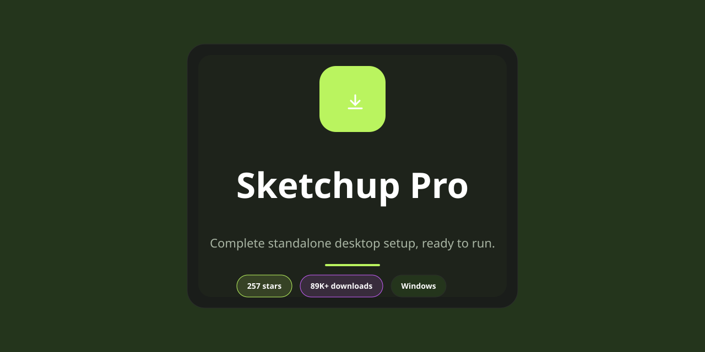

# SketchUp Pro 2026 Desktop Client for Windows 11

    

---

Sketchup Pro 2026 delivers a complete standalone desktop installation with the full feature set pre-activated and ready to run on Windows x64. The package bundles all modeling, rendering, and documentation tools into a single self-contained build, eliminating the need for separate component downloads or post-install configuration. Designed for offline deployment and rapid provisioning, the installer preserves the native desktop performance and file-handling behavior of the application. All modules are enabled by default, ensuring consistent functionality across workstations without additional setup steps.

## Features

- Complete standalone desktop installation with all application modules included and pre-configured for immediate use.
- All feature tiers are unlocked and pre-activated at install time; no separate license entry or online validation step is required.
- Full offline operation after setup: no network calls, telemetry endpoints, or account sign-in are needed to run the application.
- Native Windows x64 desktop build with installer packaging that handles dependencies, registry entries, and file associations automatically.
- Pre-configured workspace defaults, template libraries, and component catalogs are bundled so the environment is functional on first launch.
- Deterministic setup process: fixed file manifests and checksums ensure reproducible installations across machines.
- Local-only configuration state, allowing the installation to be cloned or redeployed to identical hardware without reconfiguration.
- Includes the complete feature set of the standard release—modeling tools, layout, style editing, and import/export pipelines—with no disabled modules or trial limitations.
- Designed for testing, evaluation, and isolated deployment scenarios where a self-contained desktop package is preferred over managed distribution.

## How it works

The installer operates as a self-contained deployment package that unpacks the complete Sketchup Pro 2026 application tree, registers the required system components, and configures the pre-activated license state before finalizing the desktop shortcuts. Each stage runs in sequence without requiring network access, so the entire setup can be completed on an offline workstation.

At the package level, the build bundles every runtime dependency the application expects, including the native libraries, redistributable components, and configuration templates that would otherwise be resolved during a first launch. The deployment routine validates the target environment against these dependencies before making any changes, ensuring that incompatible configurations are flagged early rather than mid-installation.

License activation is handled locally through an embedded provisioning step. Rather than contacting an external activation service, the installer writes the pre-authorized license artifacts directly into the application's configuration directory and verifies their integrity against the bundled manifest. This keeps the activation deterministic and repeatable across machines.

The setup process is idempotent by design. If an existing Sketchup Pro installation is detected, the installer inventories the current files and registry entries, reconciles them against the target build, and applies only the differences needed to reach the configured state. Repeated runs therefore converge on the same result without duplicating components or leaving orphaned artifacts.

Post-installation, the package performs a verification pass that confirms file hashes, checks that the activation state resolves correctly, and records the outcome in a local installation log. This log provides a traceable record of the deployment for auditing or troubleshooting purposes. Once verification completes, the application is ready to launch directly from the desktop without any additional configuration steps.

## Requirements

- **Operating System:** Windows 10 (version 21H2 or later) or Windows 11, 64-bit editions only. Windows 7, 8, and 8.1 are not supported. Windows Server environments are not validated for desktop deployment.

- **Processor:** 64-bit Intel or AMD multi-core CPU, 2.0 GHz minimum; 3.0 GHz or higher recommended for complex modeling and rendering workflows.

- **Memory:** 8 GB RAM minimum; 16 GB or more recommended for large assemblies, high-polygon scenes, and simultaneous operation of ancillary plugins.

- **Graphics:** Dedicated GPU with OpenGL 3.3 or higher support and at least 2 GB VRAM. Integrated graphics adapters may function but are not recommended for production use. Updated vendor drivers are required for stable viewport rendering.

- **Storage:** 2.5 GB of free disk space for the standalone installation payload, plus additional capacity for project files, autosave data, and material libraries. SSD storage recommended for responsiveness.

- **Display:** 1920x1080 resolution minimum; 2560x1440 or higher recommended for multi-panel layouts and extended toolbars.

- **Runtime Dependencies:** The standalone build bundles all required runtime components; no separate framework, library, or package manager installation is necessary. Elevated administrator privileges are required during initial deployment to register system components.

- **Permissions:** Local administrator rights on the target workstation for the initial install and first launch. Subsequent standard-user sessions are supported after activation state is established.

- **Network:** No active internet connection is required for installation or operation. An offline environment is fully supported; the build is self-contained and does not perform license validation callbacks.

- **Environment Notes:** Antivirus and endpoint protection policies may quarantine the installer payload during extraction. Ensure the deployment directory is excluded from real-time scanning prior to launch. Close all other Sketchup-family applications before running the installer to prevent file lock conflicts.

## Compatibility

The standalone desktop build is validated against the following environment matrix. Compatibility is defined at the operating-system level; no additional runtime, framework, or dependency layer is required beyond what ships with the base OS.

**Operating System**

- Windows 10 (64-bit), version 21H2 or later
- Windows 11 (64-bit), all current release channels
- Windows Server 2019 and 2022 (64-bit) are supported for deployment and testing scenarios

**Processor Architecture**

- x64 (AMD64) only; ARM-based Windows devices are not supported
- A dual-core processor at 2.0 GHz or higher is the minimum; quad-core at 2.5 GHz or higher is recommended for full feature utilization

**Memory and Storage**

- 8 GB RAM minimum; 16 GB or higher recommended for large assemblies and high-polygon scenes
- 1.3 GB of free disk space for the installation payload, plus additional headroom for user projects and caches

**Display and Graphics**

- A GPU with DirectX 11 or higher and at least 2 GB of dedicated VRAM is required for hardware-accelerated viewport rendering
- Integrated graphics are supported in compatibility mode with reduced viewport performance
- Minimum display resolution of 1920×1080 at 100% scaling; high-DPI configurations are handled natively

**File System and Permissions**

- NTFS-formatted system volume
- Local administrator privileges are required for first-run provisioning; subsequent launches operate under standard user context
- Long-path support (beyond 260 characters) must be enabled at the OS level if project directories are deeply nested

**Environment Notes**

- The build is fully standalone and does not register system-wide services, background agents, or startup entries
- Coexistence with prior versions is supported through isolated installation directories; no shared registry keys are modified
- Offline operation is fully supported after provisioning; no network callback is performed during normal use

**Known Limitations**

- Virtualized environments (Type-1 and Type-2 hypervisors) are supported for evaluation only; GPU passthrough is required for accelerated rendering
- Windows Subsystem for Linux and container-based execution are not supported targets
- Legacy Windows versions (8.1 and earlier) are explicitly out of scope and untested

## FAQ

**Is an internet connection required to run this build?**
No. The installation is fully standalone and self-contained. Once deployed, all core modules, rendering engines, and feature sets operate entirely offline. Network access is only relevant if you intend to use optional cloud-collaboration or asset-sync features, which are independent of activation.

**What does "pre-activated" mean in practical terms?**
All licensing checks and feature gates are resolved at the build level during installation. There is no separate key entry, account sign-in, or post-install registration step. Every toolset — including advanced modeling, layout, and visualization components — is unlocked on first launch.

**Which operating systems and hardware configurations are supported?**
The build targets Windows x64 desktop environments. It requires a 64-bit multi-core processor, a minimum of 8 GB RAM (16 GB recommended for large assemblies), and a dedicated GPU with current drivers for hardware-accelerated viewport rendering. A display resolution of 1920×1080 or higher is advised.

**How does the installation process work?**
The installer unpacks the complete application bundle, registers required system components, and configures the environment for immediate use. No external package managers, runtime downloads, or dependency resolution steps are involved. The entire footprint is provisioned locally during setup.

**Will this build receive automatic updates?**
No. Because the build is pre-configured and standalone, automatic update channels are disabled to preserve activation integrity. Version upgrades are delivered as complete replacement builds rather than incremental patches, ensuring consistent behavior across deployments.

**Can I run this alongside an existing installation?**
Side-by-side deployment is not recommended. Shared registry entries and component registrations may conflict with other versions. For cleanest results, remove prior installations before deploying this build.

**What happens if the application fails to launch after installation?**
Verify that the target system meets the minimum hardware requirements and that the installation completed without interruption. Confirm that antivirus or endpoint-protection software has not quarantined any bundled components. In most cases, re-running the installer restores missing registrations.

**Does this build include plugin or extension support?**
Yes. The standard extension ecosystem is available, and the extension manager functions normally. Third-party plugins are installed at the user's discretion and are not bundled with this build.

**Is telemetry or background data collection active?**
Background telemetry is disabled by default in this configuration. No usage analytics are transmitted during normal operation, consistent with the offline-first design of the build.

**How should this build be deployed in a managed or lab environment?**
For multi-seat deployment, provision the build per machine using the standalone installer, and validate hardware acceleration on each target workstation. Because activation is resolved at install time, no per-user licensing server or account provisioning is required.

## Disclaimer

This standalone build is provided as-is for evaluation, testing, and deployment in controlled desktop environments. It is a self-contained package intended to run locally without external dependencies or online activation services.

The software is distributed in a pre-configured state to streamline setup and reduce configuration overhead. No guarantees are made regarding fitness for production use, regulatory compliance, or interoperability with third-party plugins or workflows. Users are responsible for verifying that deployment aligns with their organization's licensing, security, and operational policies.

Because the build is pre-activated, certain telemetry, update-check, and license-validation routines may behave differently than in a standard retail installation. Feature parity with official releases is not guaranteed across all modules, and behavior may vary depending on the host system's configuration, locale, and security posture.

No warranty, express or implied, is provided for this distribution. The maintainers assume no liability for data loss, system instability, or damages arising from installation or use. Back up critical project files and system state before deployment, and validate the build in an isolated environment prior to broader rollout.

Redistribution, modification, or commercial use of this package is undertaken at the user's own discretion and risk. By installing or running this build, you acknowledge that you have read and accepted these terms.

